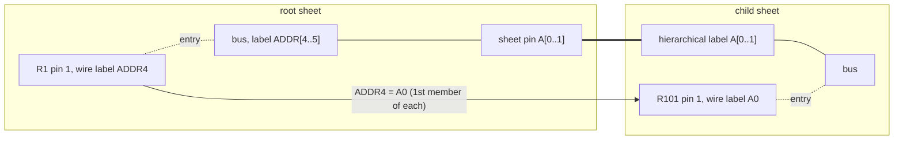
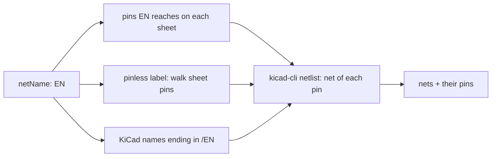

# Schematic Buses

This page describes how KiCad connects buses, and how this server follows it.
Each rule below was checked against `kicad-cli 10.0.6`: a small schematic was
built for each case, exported with `kicad-cli sch export netlist`, and the nets
read back. The same cases run as tests in `tests/test_schematic_buses.py`
whenever `kicad-cli` is installed.

## What a bus is in the file

A bus is drawn with three kinds of item:

```
(bus (pts (xy 50.8 50.8) (xy 101.6 50.8)) (stroke (width 0) (type default)) (uuid "..."))
(bus_entry (at 63.5 50.8) (size 2.54 2.54) (stroke (width 0) (type default)) (uuid "..."))
(label "D[0..7]" (at 76.2 50.8 0) ...)
```

`bus` is a two-point segment, like `wire`. `bus_entry` is the 45 degree stub
from a bus to a wire, with ends at `at` and `at + size`. KiCad joins either
end to a bus, and entries drawn in KiCad often put `at` on the wire side, so
this server takes whichever end touches a bus as the bus end. Entries it
writes put `at` on the bus. The bus gets its members from a label placed on it.
A bus with no label of its own, drawn between sheet pins, takes its members
from the pin names: a bus between two `USB{DP DN}` pins carries USB.DP and
USB.DN.

Bus aliases live in the project file in KiCad 9 and 10, under
`schematic.bus_aliases`:

```json
"schematic": { "bus_aliases": { "MEM": ["D[0..1]", "CLK"] } }
```

KiCad 8 kept them in each schematic as `(bus_alias "MEM" (members "D[0..1]" "CLK"))`.
`kicad-cli sch upgrade` drops that item from the schematic, so this server reads
both places and writes only the project file.

## Bus label syntax

| Label            | Kind   | Members                                              |
| ---------------- | ------ | ---------------------------------------------------- |
| `D[0..3]`        | vector | D0 D1 D2 D3                                          |
| `D[3..0]`        | vector | D0 D1 D2 D3 (always ascending)                       |
| `[0..1]`         | vector | 0 1                                                  |
| `I2C{SDA SCL}`   | group  | I2C.SDA I2C.SCL                                      |
| `{SDA SCL}`      | group  | SDA SCL                                              |
| `{A,B}`          | group  | A B (commas work as well as spaces)                  |
| `M{D[0..1] CLK}` | group  | M.D0 M.D1 M.CLK                                      |
| `{~{RST} CLK}`   | group  | ~{RST} CLK (`~{}` is an overbar, not a group)        |
| `{MEM}`          | group  | D0 D1 CLK, with alias MEM = [D[0..1], CLK]           |
| `U{MEM X}`       | group  | U.D0 U.D1 U.CLK U.X                                  |
| `MEM`            | none   | a plain net label; ERC reports a bus-to-net conflict |
| `~{CS}[0..1]`    | vector | ~{CS}0 ~{CS}1 (formatting stays in the names)        |
| `P{A B}x`        | group  | P.A P.B (text after the brace is ignored)            |
| `D[2..2]`        | none   | a one-member range is not a bus                      |
| `A{B{C D} E}`    | none   | a group inside a group is not a bus                  |
| `D[0..3] `       | none   | leading or trailing spaces make it a plain label     |

The parser is `python/commands/bus_names.py`.

## How members connect

On one sheet, a wire joins a bus member only through its own label. A bus
entry links the wire to the bus graphically, and nothing more. In the flat test
sheet below, four resistors hang off a bus labelled `D[0..3]` through bus
entries:

| Wire label | KiCad net   | ERC                               |
| ---------- | ----------- | --------------------------------- |
| D1 (R1)    | /D1 with R3 | none                              |
| none (R2)  | unconnected | net_not_bus_member, Net-(R2-Pad1) |
| D1 (R3)    | /D1 with R1 | none                              |
| X9 (R4)    | /X9 alone   | net_not_bus_member                |

Across a sheet pin, KiCad pairs the members of the parent's bus with the
members of the bus inside the sheet:

- **Vector to vector:** by position, after both sides are sorted ascending.
- **Group to group:** by member name, without the group prefix.
- **Vector to group:** KiCad's netlist for this case is irregular (parent
  `ADDR[0..1]` to pin `{A0 A1}` put both child pins on /ADDR0 and left /ADDR1
  with one), and ERC reports net_not_bus_member. Avoid this wiring.

The joined net takes the parent's name. A member of a bus with a global label
is a global net.



### Results from kicad-cli 10.0.6

Each row is a root sheet with a labelled bus to a bus sheet pin, and a child
sheet whose hierarchical label matches the pin. Parent members feed R1, R2,
and so on; child members feed R101, R102.

| Parent bus label | Sheet pin          | Parent wires      | Child wires     | KiCad nets with two pins             |
| ---------------- | ------------------ | ----------------- | --------------- | ------------------------------------ |
| `ADDR[0..1]`     | `A[0..1]`          | ADDR0 ADDR1       | A0 A1           | /ADDR0: R1 R101, /ADDR1: R2 R102     |
| `ADDR[0..1]`     | `A[1..0]`          | ADDR0 ADDR1       | A0 A1           | /ADDR0: R1 R101, /ADDR1: R2 R102     |
| `ADDR[1..0]`     | `A[0..1]`          | ADDR0 ADDR1       | A0 A1           | /ADDR0: R1 R101, /ADDR1: R2 R102     |
| `ADDR[4..5]`     | `A[0..1]`          | ADDR4 ADDR5       | A0 A1           | /ADDR4: R1 R101, /ADDR5: R2 R102     |
| `ADDR[0..3]`     | `A[0..1]`          | ADDR0 ADDR1 ADDR2 | A0 A1           | /ADDR0: R1 R101, /ADDR1: R2 R102     |
| `I2C{SDA SCL}`   | `BUS{SDA SCL}`     | I2C.SDA I2C.SCL   | BUS.SDA BUS.SCL | /I2C.SDA: R1 R101, /I2C.SCL: R2 R102 |
| `I2C{SDA SCL}`   | `{SDA SCL}`        | I2C.SDA I2C.SCL   | SDA SCL         | /I2C.SDA: R1 R101, /I2C.SCL: R2 R102 |
| `{SDA SCL}`      | `{X Y}`            | SDA SCL           | X Y             | none                                 |
| `M{D[0..1] CLK}` | `N{D[0..1] CLK}`   | M.D0 M.CLK        | N.D0 N.CLK      | /M.D0: R1 R101, /M.CLK: R2 R102      |
| `M{D[0..1]}`     | `N{E[0..1]}`       | M.D0 M.D1         | N.E0 N.E1       | none                                 |
| `{MEM}`          | `{MEM}`            | D0 CLK            | D0 CLK          | /D0: R1 R101, /CLK: R2 R102          |
| `U{MEM}`         | `V{MEM}`           | U.D0 U.CLK        | V.D0 V.CLK      | /U.D0: R1 R101, /U.CLK: R2 R102      |
| `MEM` (bare)     | `MEM`              | D0 CLK            | D0 CLK          | none                                 |
| global `G[0..1]` | `P[0..1]`, no port | G0 G1             | G0 G1           | G0: R1 R101, G1: R2 R102             |

With an unlabelled parent bus, the child members keep their own names
(/child/A0).

## Where the server gets nets

Which labels are one net depends on the sheet each local label belongs to,
sheet pins, bus pins, global labels and power ports, and on how many times a
sheet is used. Matching label names across the design gets this wrong: two
sub-sheets that each have a hierarchical label `EN` are two nets in KiCad. So
`list_schematic_nets`, `get_net_connections` and `sync_schematic_to_board`
take the design's nets from `kicad-cli sch export netlist`, which runs KiCad's
connectivity code, and use KiCad's net names (`/ADDR0`, `/child/A0`, `GND`).
The board then gets the same nets and names that KiCad's own F8 gives.

A caller usually asks about a net by a label it can see. The server maps a
label to KiCad nets in three ways, in `python/commands/design_netlist.py`:

1. The pins the label reaches on its own sheet; KiCad's net for those pins.
2. For a label with no pins on its sheet, a walk along its wire through the
   hierarchical labels and sheet pins of specific sheets until a wire reaches
   pins. Each step follows one concrete sheet symbol, so nets that only share a
   label name are never mixed.
3. KiCad net names equal to the label, or ending in `/` and the label.



Worked example from the light-ring design, which has six sub-sheets with a
hierarchical label `EN`, each wired in the root to its own PWM net. Asking
for `EN` gives six nets, `/LED_PWM_IR850` through `/LED_PWM_WHITE6500K`, 18
pins in total, and the warning that `EN` names 6 separate nets. Asking for
`LED_PWM_UV310` gives one net with 3 pins. Across that design and two others
(aphid, 986_fan_controller), the nets `list_schematic_nets` reports equal
kicad-cli's netlist exactly; each query takes 1 to 3 seconds.

Without kicad-cli the tools fall back to label names: pins are collected per
label name across all sheets, sheet pins that rename a net are not followed,
and every response says so in `warnings` with `connectivitySource: "labels"`.

## Junctions

A segment that ends on the middle of another segment of the same kind joins it
only through a junction. Two wires from R1 and R2 meet a horizontal wire, and a
third wire from R3 ends on the middle of it:

| Junction at the T | KiCad net               |
| ----------------- | ----------------------- |
| absent            | Net-(R1-Pad2): R1 R2    |
| present           | Net-(R1-Pad2): R1 R2 R3 |

`WireManager.sync_junctions` runs after every wire or bus edit, and after
moving or rotating a symbol. At each point it counts connections: one per
segment end, one per symbol pin or sheet pin (sheet pins only, for buses), and
two per segment passing through the point. It keeps any existing junction with
three or more, and adds one where a segment ends and three or more meet.
These existing junctions were each checked with kicad-cli to be needed, and
are kept:

| Junction at                         | Connections |
| ----------------------------------- | ----------- |
| a T on a straight or 45 degree wire | 1 + 2       |
| a crossing of two wires             | 2 + 2       |
| a pin on the middle of a wire       | 1 + 2       |

A plain crossing without a junction stays unjoined, as in KiCad. Wires and
buses are counted separately: a wire crossing a bus gets no junction.

## Connecting pins with `connect_pins_to_bus`

Each pin gets a bus entry, a straight wire to the pin and a label naming its
member. A vertical bus feeds horizontal wires at each pin's y; a horizontal
bus feeds vertical wires at each pin's x. The entry's wire end is 2.54 mm off
the bus toward the pin. Its bus end is 2.54 mm along the bus before the pin,
or after it when the point before lies past the end of the bus.

Worked example, from `tests/test_schematic_buses.py`: a vertical bus from
(50.8, 40.64) to (50.8, 81.28), and pin U1/3 at (63.5, 55.88) facing left.

```
        x=50.8
          |
          |  bus end (50.8, 53.34)
          | \
          |  \ entry, size (2.54, 2.54)
          |   \
          |    o------------------------o  U1/3 (63.5, 55.88)
          |   (53.34, 55.88)
          |    label "D3", angle 0, text runs toward the pin
          |
```

A pin is matched to the nearest bus segment it faces. A segment it faces away
from is used only when no other segment can take it, and the response warns.
If any pin cannot be placed, or a net is not a member of the bus's label,
nothing is written.

## Limits

- A label in a sheet that is used more than once maps to the KiCad net of the
  use whose references the file stores. The nets themselves come from KiCad
  and are right for every use.
- In the fallback without kicad-cli, `list_schematic_nets` and
  `get_net_connections` treat a wire T without a junction as connected, and a
  local label name as one net across all sheets.
- Bus entries are checked for membership against all bus labels on the bus
  network. When a network carries labels with different members, the bus
  report lists that as a problem, since KiCad uses only one of them.
